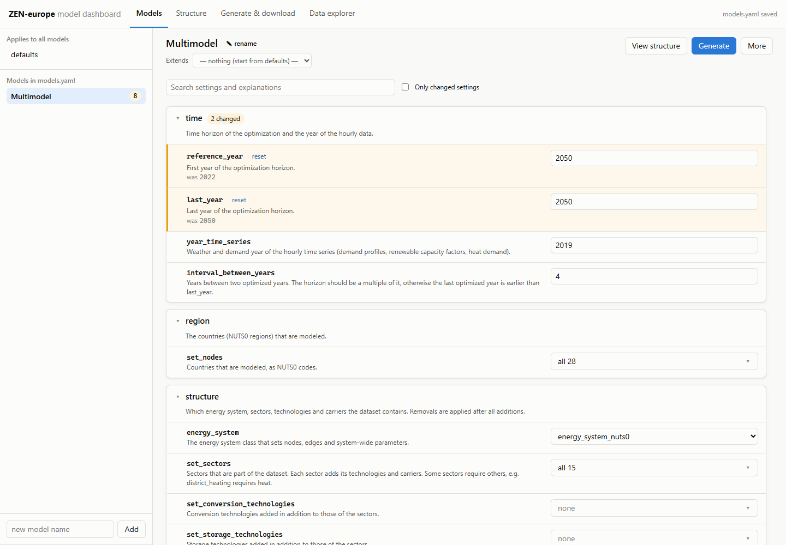
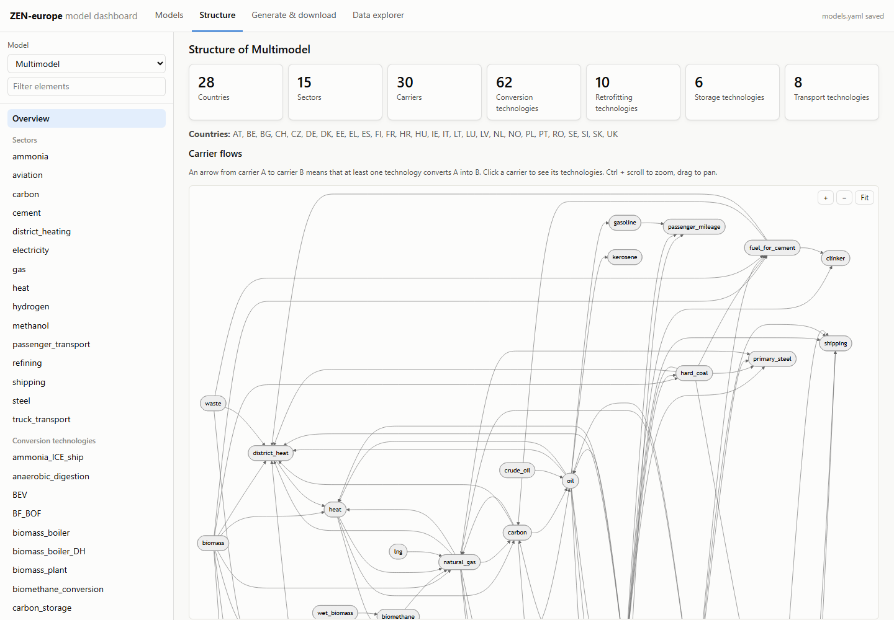
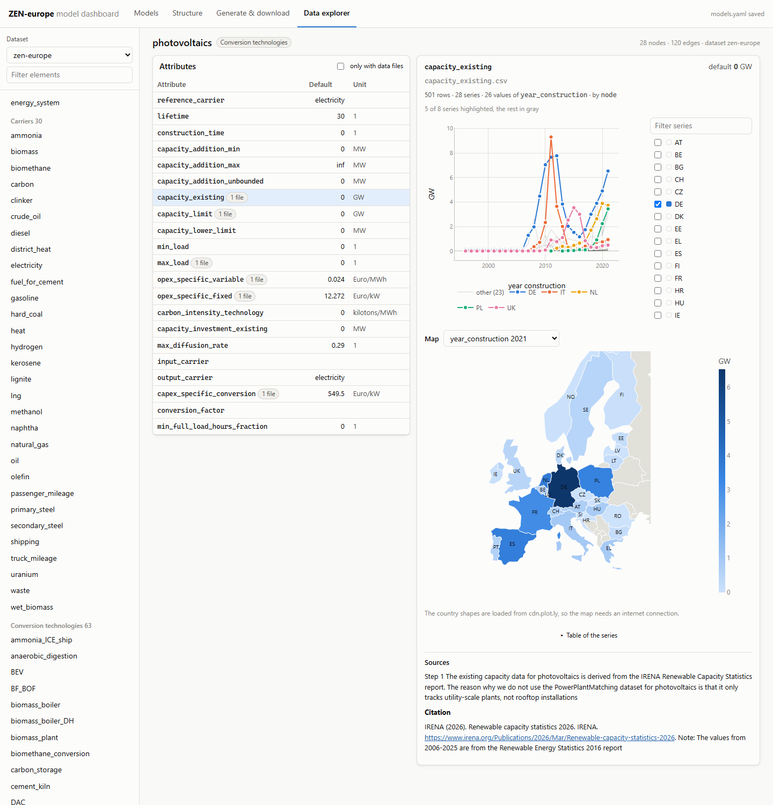

.. _dashboard.dashboard:

###########################
Dashboard (beta)
###########################

.. note::

   The dashboard is a **beta version**. It is meant to be run locally by one
   user, and its interface may still change. Please report problems and ideas
   as GitHub issues.

The dashboard in ``dashboard/`` is a web interface to create ZEN-europe
datasets without editing YAML files by hand. It does four things:

1. **Configure models.** Declare variants of the dataset in a models file
   (see :ref:`tutorials.models_file`). Every setting is shown with a short
   explanation, its inherited value and whether the variant changes it.
2. **Show the structure.** The sectors, technologies and carriers of a variant
   and how they connect, as on the :ref:`model structure pages
   <model_structure.index>`, recomputed while the settings change.
3. **Generate and download.** Generate the variants and download each dataset
   as a zip that ZEN-garden can run.
4. **Explore the data.** Browse a generated dataset by element and attribute,
   with charts along time or years, maps per country or edge, and the sources
   of every value.

The dashboard does not change how datasets are created. It reads the settings,
sectors and elements from ZEN-europe, and generates a dataset with the same
command a user would run (see :ref:`execution.execution`):

.. code-block:: shell

   python -m zen_europe --model <name> --models_path dashboard/workspace/models.yaml \
       --config_path data/zen_europe_config.yaml \
       --output_path dashboard/workspace/created_models

Installation
============

The dashboard has a Python backend, which runs in the ZEN-europe environment,
and a web frontend, which is built once with `Node.js <https://nodejs.org>`_
(version 20 or newer).

.. code-block:: shell

   conda activate zen-europe-env
   pip install -e ".[dashboard]"

   cd dashboard/frontend
   npm install
   npm run build

The frontend only has to be built again after it changed.

Starting the dashboard
======================

.. code-block:: shell

   cd dashboard/backend
   python -m zen_dashboard

Then open http://127.0.0.1:8000 in a browser. ``--port`` selects another port.
The dashboard can be started from any folder: it finds ZEN-europe, its
configuration file and the raw data through the installed ``zen_europe``
package.

Using the dashboard
===================

Models
------

The left side lists the models of the models file, and **defaults**, the
settings that apply to every model. A new model starts from the defaults, or
from another model it **extends**. More actions (a variant that extends the
current model, duplicate, delete) are under **More**.

The settings are grouped by category. Each setting shows what it does, and
the value the model would have without it. A changed setting is highlighted,
shows the value it replaces, and can be reset. Use the search box to find a
setting, or show only the changed settings. The rarely needed ``cache``
settings are collapsed.

The settings that add elements (``set_conversion_technologies`` to
``set_carriers``) only offer the elements that the model does not contain yet,
and the settings that remove elements (``remove_sectors``,
``remove_technologies``) only offer those that it contains.

Changes are checked while you type, with the same validation that ZEN-europe
applies. A model with invalid settings is marked red and cannot be saved. A
model whose structure cannot be generated, for example because a technology
uses a carrier that was removed, is marked orange: it can be saved but not
generated. **Save models.yaml** in the header writes the models file.

Structure
---------

The structure view shows the model selected in the models view, including
unsaved changes. The overview counts the countries, sectors, carriers and
technologies, lists what the model adds or removes compared to the
configuration file, and draws the carrier flows. The list on the left opens a
sector, technology or carrier with its diagram, and clicking an element in a
diagram opens it. Ctrl + scroll zooms a diagram and dragging pans it.

Generate & download
-------------------

Select models and click **Generate**. Unsaved changes are saved first. The
models are generated one after another, which usually takes a few seconds per
model. The log of a running model is shown live, and a model can
be cancelled.

Every generated dataset can be downloaded as a zip. It contains the dataset
folder and a ``config.yaml`` that points ZEN-garden to it, so it can be run
right after unpacking:

.. code-block:: shell

   zen_garden --config ./config.yaml --dataset ./<name>

Data explorer
-------------

Select a dataset and an element (the energy system, a carrier or a
technology) to see its attributes with their default values and units. An
attribute with data files shows its data:

- along ``time``, ``year`` or ``year_construction`` as a line chart. Up to eight
  series (for example countries) are highlighted in color, the others are drawn
  in gray. Hourly series can be shown as daily or weekly means.
- per country or edge as a bar chart.
- per country or edge on a map, for one year or aggregated over time. Each
  direction of an edge is drawn from its origin to the middle of the edge.

An attribute with a yearly variation, the factor ZEN-garden multiplies its
value with in each year, is shown as it is used in each year:

- without a data file: the default value times the factor, as a line over the
  years.
- with a data file per node or edge: each value times the factor, as one line
  per node or edge over the years. A node without a factor keeps its value.
- with a data file along time: the hourly data and the factor, one below the
  other.

The files themselves are available as further tabs. **Sources and citations**
expands the sources of the attribute, as written to the ``sources.md`` of the
element.

**Highlight changes compared to** selects a reference dataset. By default,
this is **ZEN-europe defaults**, the dataset of the configuration file without
any model changes, so the highlighted values are those that a model changes.
The dashboard generates the defaults once, after the first generated model or
with **Generate the defaults**, and keeps them in ``workspace/reference/``. It
generates them again when the configuration file, the commit or the version of
ZEN-europe or ZEN-creator changed. Any other generated dataset can be selected
as the reference as well. Elements that differ are marked in the list, elements that are new or
only in the reference are labeled, and changed attributes are highlighted with
their previous default value and the data files that differ. **only changed**
hides everything else. The address of the page contains the dataset
and element, so a view can be bookmarked or shared.

Files
=====

Everything the dashboard writes goes to ``dashboard/workspace/``, which is not
part of the repository. The folder can be moved with the environment variable
``ZEN_DASHBOARD_WORKSPACE``.

.. list-table::
   :header-rows: 1
   :widths: 35 65

   * - Path
     - Content
   * - ``workspace/models.yaml``
     - The models file edited in the dashboard. It is copied from
       ``data/models.yaml`` on the first start, and has the same format, so
       ``zen-europe --all --models_path dashboard/workspace/models.yaml``
       reproduces the datasets.
   * - ``workspace/created_models/``
     - The generated datasets.
   * - ``workspace/logs/``
     - The log of every generation.
   * - ``workspace/meta/``
     - When each dataset was generated and with which settings.
   * - ``workspace/reference/``
     - The dataset of the defaults, to highlight what the models change.

The configuration file is ``data/zen_europe_config.yaml``. Another one is
selected with the environment variable ``ZEN_EUROPE_CONFIG``.

Limitations
===========

- The explanations of the settings are kept in
  ``dashboard/backend/zen_dashboard/descriptions.py``. A new setting is shown
  without explanation until it is added there.
- The list of generation jobs is kept in memory and is empty after a restart.
  The datasets and logs remain in the workspace.
- The maps load the country shapes from cdn.plot.ly and need an internet
  connection.
- The dashboard has no authentication. Do not expose it beyond your own
  computer.

Development
===========

For changes to the frontend, run the backend as above and, in a second
terminal, the development server with hot reloading on
http://127.0.0.1:5173:

.. code-block:: shell

   cd dashboard/frontend
   npm run dev

``npm run check`` type-checks the frontend. The backend is checked with
``black``, ``ruff`` and ``mypy`` like the rest of ZEN-europe. The code is
organized as follows:

.. list-table::
   :header-rows: 1
   :widths: 45 55

   * - Path
     - Content
   * - ``backend/zen_dashboard/app.py``
     - The HTTP API.
   * - ``backend/zen_dashboard/catalog.py``
     - The settings and the values they accept, read from the registries of
       ZEN-creator.
   * - ``backend/zen_dashboard/descriptions.py``
     - The explanations of the settings.
   * - ``backend/zen_dashboard/models_file.py``
     - Reading, validating and writing the models file.
   * - ``backend/zen_dashboard/structure.py``
     - The structure of a model, computed with ``zen_creator.model_structure``,
       and the checks that would otherwise only fail when a dataset is
       written.
   * - ``backend/zen_dashboard/jobs.py``
     - The queue that runs the ZEN-europe command line interface.
   * - ``backend/zen_dashboard/datasets.py``
     - Reading the elements, attributes, data files and sources of a dataset.
   * - ``frontend/src/views/``
     - The four views of the dashboard (Svelte).
